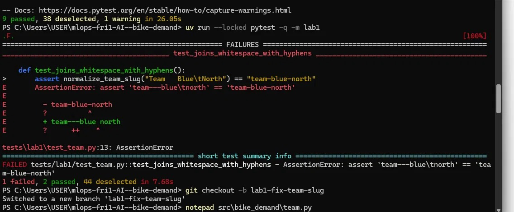
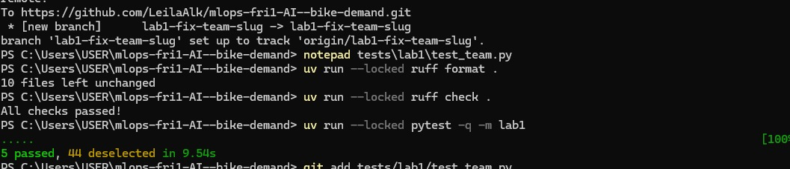
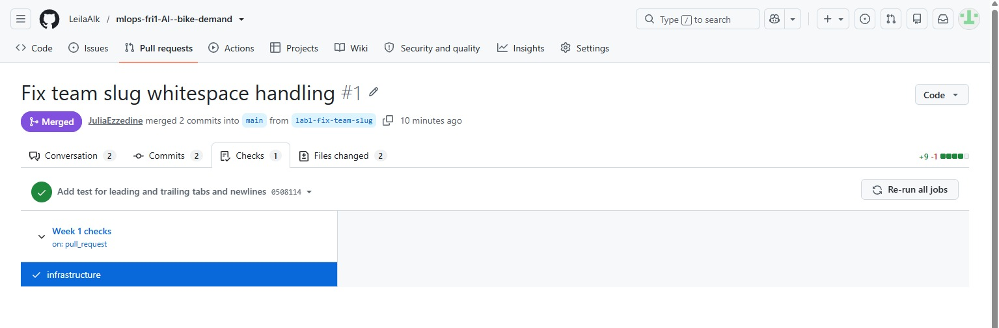
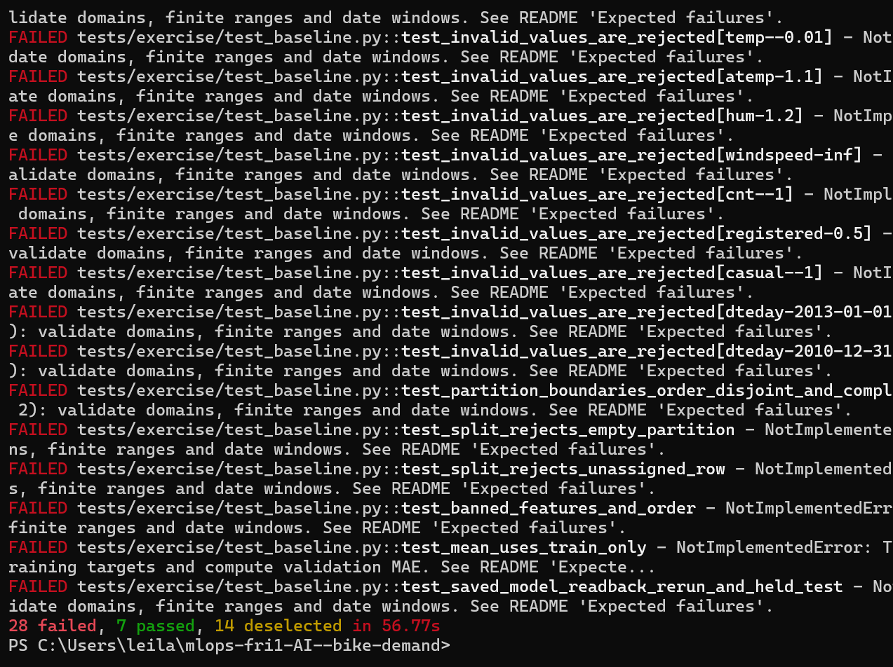
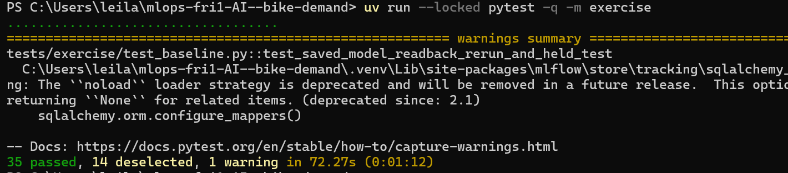
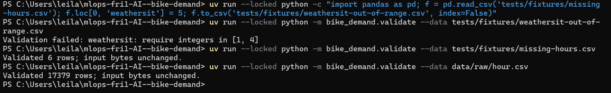
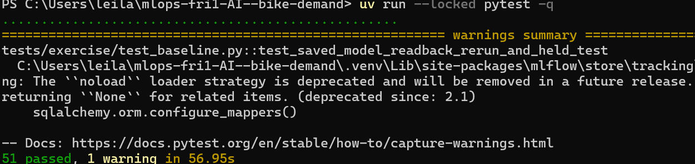
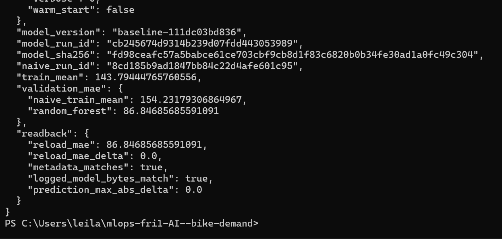
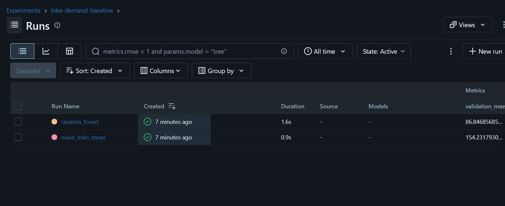

# Week 1, Labs 1–2: team evidence

## Team and roles

Team AI: Julia (@JuliaEzzedine), Leila (@LeilaAlk), Talia (@taliaalg), Andrea (@andrea180904).
Lab 1 fix (PR #1): Julia driver and author, Leila reviewer and repository owner.
Lab 1 docs PR: Talia driver and author, Andrea reviewer.
Lab 2 (PR lab02/data-baseline): Leila driver and author, Julia reviewer, Talia evidence and team report, Andrea Fault B design.

## Repository and pull requests

Repository: https://github.com/LeilaAlk/mlops-fri1-AI--bike-demand
PR #1 "Fix team slug whitespace handling": branch lab1-fix-team-slug, commits 6c2c77f and 0508114, approved by Leila, merged to main as 9b0a16a.
Docs PR: branch lab1-docs, working agreement, Lab 1 report and docstring.

## Setup, preflight and quality checks (commands and actual results)

Windows x86_64, Python 3.12.15, uv 0.12.24.
- `uv sync --locked` -> 97 packages installed
- `uv run --locked python -m bike_demand.preflight` -> Preflight passed: imports, frozen snapshot and writable outputs.
- `uv run --locked pytest -q -m infra` -> 9 passed
- `uv run --locked pytest -q -m lab1` -> 1 failed, 2 passed before the fix (intentional failure); 5 passed after the fix
- `uv run --locked ruff check .` -> All checks passed!
- `uv run --locked ruff format --check .` -> 10 files already formatted (after `ruff format .` fixed 2 files)
- CI: workflow "Week 1 checks", job "infrastructure" -> passed on 0508114

## Data identity, validator checks and added test

Canonical data: data/raw/hour.csv, sha256 e03de4ee4ef4dc376ac6e04bf829673c6269e8eba5c60fa121640fa2f829504f. python -m bike_demand.validate --data data/raw/hour.csv -> "Validated 17379 rows; input bytes unchanged."
Validator rules implemented in check_domains: integer categories inside their domains, finite weather values in [0, 1], nonnegative integer counts, dates between 2011-01-01 and 2012-12-31. Each rejection names the failing field; nothing is filled, clipped or dropped.
Tests: pytest -q -m exercise -> 28 failed, 7 passed before implementation; 35 passed after. Added test file tests/exercise/test_fault_b.py (2 tests). Full suite pytest -q -> 51 passed. ruff check . -> All checks passed!

## Partition counts, boundaries and held test rows

Sorted by (dteday, hr, instant); no shuffle. Each row belongs to exactly one partition (17379 = 8645 + 4358 + 4376).
 train: 8645 rows, 2011-01-01 to 2011-12-31
 validation: 4358 rows, 2012-01-01 to 2012-06-30
 test: 4376 rows, 2012-07-01 to 2012-12-31, held: never used for fitting or evaluation, no test metric computed
First and last (dteday, hr, instant) keys per partition:
train 8645 [Timestamp('2011-01-01 00:00:00'), np.int64(0), np.int64(1)] [Timestamp('2011-12-31 00:00:00'), np.int64(23), np.int64(8645)]
validation 4358 [Timestamp('2012-01-01 00:00:00'), np.int64(0), np.int64(8646)] [Timestamp('2012-06-30 00:00:00'), np.int64(23), np.int64(13003)]
test 4376 [Timestamp('2012-07-01 00:00:00'), np.int64(0), np.int64(13004)] [Timestamp('2012-12-31 00:00:00'), np.int64(23), np.int64(17379)]

## Comparator and RF: run IDs, validation MAEs, metadata/readback

Training commit: a7d0c77b8ef5377d49ca82d68be8f025a5ece8c6 (working_tree_dirty: false). Config: configs/baseline.yaml, twelve ordered predictors, RF n_estimators=50, max_depth=10, random_state=42, n_jobs=1. Both predictors fitted on train only and evaluated on the same 4358 validation rows.
- naive_train_mean: run 8cd185b9ad1847bb84c22d4afe601c95, train mean 143.794 rentals/hour, validation MAE 154.232
- random_forest: run cb245674d9314b239d07fdd443053989, validation MAE 86.847, model version baseline-111dc03bd836, model sha256 fd98ceafc57a5babce61ce703cbf9cb8d1f83c6820b0b34fe30ad1a0fc49c304
Readback: saved artifacts/model.joblib reloaded, reload MAE 86.847 (delta 0.0), metadata matches, logged model bytes match. Both runs visible in the local MLflow UI (sqlite:///tracking/mlflow.db), experiment bike-demand-baseline.
The RF has a lower validation MAE than the train-mean comparator on these rows. This is a fixed comparison, not a tuned or test-set result.

## Optional stretch, after the core: unchanged-config repeat (new run IDs, history, differences)

Not attempted.

## Fault diagnosis and your own Fault B

Choice: we broke the categorical domain rule for `weathersit` by setting it to 5 (allowed: 1 to 4) on one training row of a copy of missing-hours.csv, keeping all columns (tests/fixtures/weathersit-out-of-range.csv). Designed by Andrea, implemented by Leila.
Reason: an undefined weather code would otherwise reach the model as if it were a real category, for example after an upstream encoding change, and distort predictions without any error.
Result: "Validation failed: weathersit: require integers in [1, 4]". Valid control missing-hours.csv -> "Validated 6 rows". Canonical hour.csv revalidated unchanged (17379 rows). Limitation: the validator checks ranges, not plausibility, so a wrong but in-range code would still pass.

## Review observation and author's response

PR #1: Leila asked for a test on leading/trailing tabs and newlines; Julia added `test_trims_tabs_and_newlines` in 0508114 (lab1: 5 passed). Leila also asked for a one-line docstring on `normalize_team_slug`; it was not in PR #1 and is added in the docs PR.

## Contribution and assistance/recovery acknowledgement

Julia: bug fix and two tests (PR #1). Leila: repository creation, access management, review of PR #1. Talia: working agreement, Lab 1 report, docstring (docs PR). Andrea: review of the docs PR.
Assistance: course starter repository; an AI assistant (Claude) helped with the setup, the bug diagnosis, the fix, the test ideas and the wording of the reports.
Recovery: first push rejected because the repository was created with a README (merged unrelated histories), then because the token lacked the workflow scope (scope added).

Lab 2: Leila implemented and ran the pipeline, Andrea designed Fault B, Talia recorded evidence and the team report, Julia reviewed. Assistance: an AI assistant (Claude) provided the implementation of the TODO functions and the Fault B test, which the team ran, checked against the tests and reviewed.

## Blockers and next action

No blocker. Leila and Andrea confirm their local setup. Lab 2 driver and reviewer to be decided at the start of Lab 2.

## Screenshots

Save images in `reports/images/`; embed each with a caption naming the commit or run
it shows (for example PR checks, MLflow runs, validator output). Hide tokens and
personal data.

Failing `pytest -m lab1` on the starter commit a869cc8: 1 failed, 2 passed.

Passing `pytest -m lab1` on commit 0508114: 5 passed.

"Week 1 checks / infrastructure" passed on PR #1, commit 0508114.

`pytest -m exercise` before implementation: 28 failed, 7 passed.

`pytest -m exercise` after implementation: 35 passed.

Fault B rejected (weathersit), valid control and canonical data accepted.

`pytest -q` full suite: 51 passed.

Training on commit a7d0c77: run IDs, validation MAEs and readback.

MLflow UI: runs random_forest (cb245674) and naive_train_mean (8cd185b9).