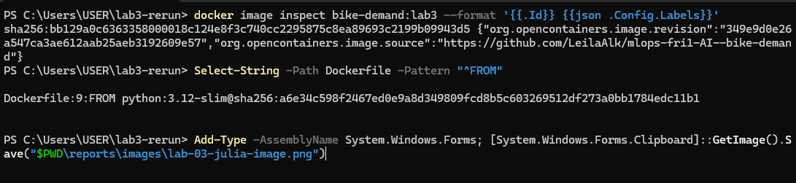
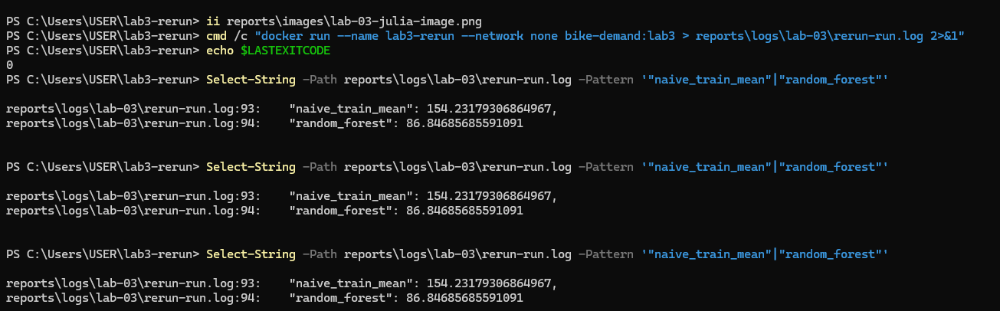
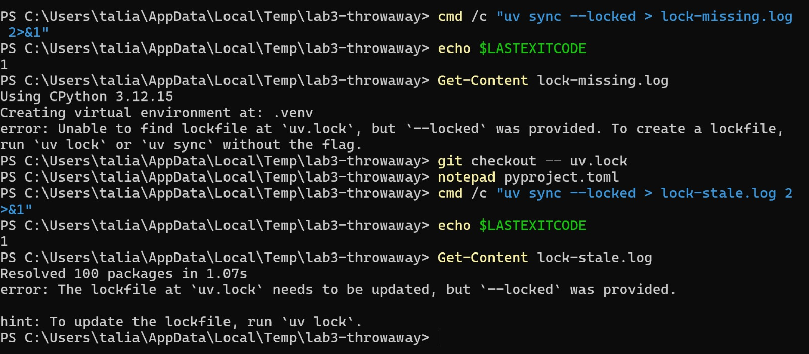
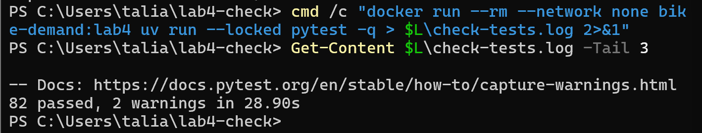
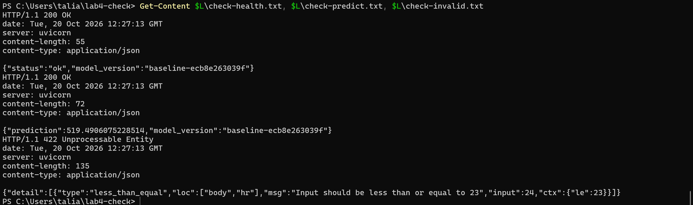
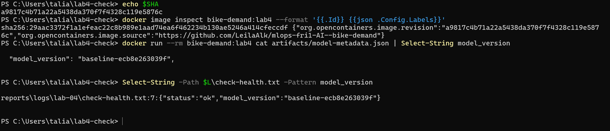

# Week 2, Lab 3: team evidence

## Team and roles

| Area | Author | Reviewer | PR |

| --- | --- | --- | --- |

| Lock | Talia (@taliaalg) | Julia | #9 |

| Dockerfile | Andrea (@andrea180904) | Leila | #8 |

| README + team report | Leila (@LeilaAlk) | Andrea | #10 |

| Clean rerun | Julia (@JuliaEzzedine) | Talia | #11 |

## Revision

Packaged commit: [349e9d0e26a547ca3ae612aab25aeb3192609e57](https://github.com/LeilaAlk/mlops-fri1-AI--bike-demand/commit/349e9d0e26a547ca3ae612aab25aeb3192609e57), with [uv.lock at that commit](https://github.com/LeilaAlk/mlops-fri1-AI--bike-demand/blob/349e9d0e26a547ca3ae612aab25aeb3192609e57/uv.lock) (SHA-256 in [rerun-uvlock-sha256.txt](logs/lab-03/rerun-uvlock-sha256.txt)).

## Image

Fresh clone, `docker build --no-cache` by Julia, who wrote neither the Dockerfile nor the README. [Build log](logs/lab-03/rerun-build.log), [image inspect](logs/lab-03/rerun-image-inspect.json). Image ID `sha256:bb129a0c6363358000018c124e8f3c740cc2295875c8ea89693c2199b09943d5`, label `org.opencontainers.image.revision` = `349e9d0e26a547ca3ae612aab25aeb3192609e57`, base `python:3.12-slim@sha256:a6e34c598f2467ed0e9a8d349809fcd8b5c603269512df273a0bb1784edc11b1`.

## Run and comparison with Lab 2

Run with `--network none`: [run log](logs/lab-03/rerun-run.log), [metrics](logs/lab-03/container-metrics.json), [model metadata](logs/lab-03/container-model-metadata.json), [tests](logs/lab-03/rerun-tests.log) (`51 passed`).

| Field | Lab 2 (commit a7d0c77) | Container | Why |
| --- | --- | --- | --- |
| MAE train mean | 154.2318 | 154.2318 | Same data, split and computation |
| MAE random forest | 86.8469 | 86.8469 | random_state=42, n_jobs=1, same locked versions |
| data_sha256 | e03de4ee | same | Frozen snapshot checked by preflight |
| training_commit | a7d0c77 | unavailable | .git is not in the image; commit is in the image label |
| working_tree_dirty | false | null | Same reason |
| RF run ID | cb245674 | 5c53d233 | New run on every execution |
| model_sha256 | fd98ceaf | different | Byte-identical models are not promised across systems |

## Lock checks

[lock-check.log](logs/lab-03/lock-check.log) passes; [lock-missing.log](logs/lab-03/lock-missing.log) and [lock-stale.log](logs/lab-03/lock-stale.log) fail with `uv sync --locked` (exit code 1); [docker-lock-stale.log](logs/lab-03/docker-lock-stale.log) (generated by Julia in a throwaway clone) shows the image build stopping at `RUN uv sync --locked --no-install-project`. The lock was never regenerated. Both ways of making the lock stale (editing `pyproject.toml` by hand for lock-stale.log, `uv add --frozen "httpx>=0.27"` for docker-lock-stale.log) add the same dependency without updating `uv.lock`, and both fail with the same error: `The lockfile at uv.lock needs to be updated, but --locked was provided`.

## Reviews

PR #9 (lock check) reviewed by Julia: lock logs lacked a reproduction header (commit, command) and ci.yml was missing its final newline; fixed by Talia in a07ca12.

PR #8 (Dockerfile) reviewed by Leila: the comment above FROM still said to replace the tag with a digest although the digest was already pinned; asked to remove or update it.

PR #10 (README + team report) reviewed by Andrea: the build command in the README tagged the image bikedemand:lab3 instead of bike-demand:lab3, and the headings in week-02-team.md were escaped; both fixed by Leila.

PR #11 (clean rerun) reviewed by Talia: docker-lock-stale.log was produced with uv add --frozen while lock-stale.log edited pyproject.toml by hand; added a line in Lock checks stating that both methods give the same failure.

## Blocked steps

None so far.

## Local runs vs CI

Docker builds and reruns were run locally. CI checks `uv lock --check`, `uv

sync --locked`, preflight, ruff and tests; it does not build the image.

## Lab 4: prediction API

### Team and roles

| Area | Author | Reviewer | PR |
| --- | --- | --- | --- |
| Request schema + API dependencies | Talia | Julia | #12 |
| API: load model, /health, /predict | Leila | Talia | #13 |
| API tests (normal, invalid, missing model) | Julia | Andrea | #14 |
| Dockerfile (serve) + README | Andrea | Leila | #15 |
| Final container check + this section | Talia | Andrea | #<this PR> |

### Contract

Two endpoints sharing one model-availability state: `GET /health` (200 with the
loaded `model_version`, or 503) and `POST /predict` (200 with a finite non-negative
`prediction` and `model_version`; 422 for invalid input; 503 without a model).
Twelve input fields with the training ranges; extra fields (including `cnt`,
`casual`, `registered`) are rejected with 422. `model_version` comes from
`artifacts/model-metadata.json`. The model is trained once at image build time;
the service never trains.

### Evidence from the built image

Fresh clone of `main` at `a9817c4b71a22a5438da370f7f4328c119e5876c`,
`docker build --no-cache`, by Talia (who did not write the Dockerfile or the API).

- Identity: commit `a9817c4b71a22a5438da370f7f4328c119e5876c` (image label
  `org.opencontainers.image.revision`), image ID
  `sha256:29aac3372f1a1efeac22c8b989e1aad74ea6f462234b130ae5246a414cfeccdf`,
  served `model_version` `baseline-ecb8e263039f`, identical to the one in the
  image's `artifacts/model-metadata.json`
  ([image inspect](logs/lab-04/check-image-inspect.json), [build log](logs/lab-04/check-build.log)).
- Tests inside the image: `82 passed, 2 warnings` ([check-tests.log](logs/lab-04/check-tests.log)).
- Valid request: [request](logs/lab-04/check-request.json) ->
  [200 response](logs/lab-04/check-predict.txt), prediction 519.49.
- Invalid request (`hr: 24`): [422 response](logs/lab-04/check-invalid.txt)
  ("Input should be less than or equal to 23").
- Health: [200](logs/lab-04/check-health.txt); without a model
  (`BIKE_DEMAND_MODEL_DIR=/app/no-model`):
  [503 health](logs/lab-04/check-nomodel-health.txt),
  [503 predict](logs/lab-04/check-nomodel-predict.txt).
- The local run of PR #13 served `baseline-4a3abd683182` with the same
  prediction (519.49): `model_version` changes on every training run, the
  prediction does not.

### Reviews

- Schema PR (#12) reviewed by Julia: `extra="forbid"` also rejects `cnt`,
  `casual` and `registered`; asked to document it in the README. Talia added a
  "Lab 4: request validation" section in `9abb2a8`.
- API PR (#13) reviewed by Talia: ran it locally (health 200, predict 200,
  `hr=24` -> 422; without a model -> 503 on both routes) and asked why a negative
  or non-finite prediction returns 500 rather than 503. The PR was merged before
  the review was submitted, so this review is post-merge.
- Tests PR (#14) reviewed by Andrea: break test, changed the `hr` bound in
  `schemas.py` from `le=23` to `le=24`; `test_out_of_range_is_rejected[hr-24]`
  (200 instead of 422) and `test_invalid_request_without_model_is_422` (503
  instead of 422) both caught it.
- Dockerfile PR (#15) reviewed by Leila: the model is trained at build time, so
  `model_version` changes on every rebuild without cache; asked to document it
  in the README. <response>
- Container check PR (#<this PR>) reviewed by Andrea: <finding>

### Blocked steps

First `docker build --no-cache` failed (exit code 1) at
`COPY --from=ghcr.io/astral-sh/uv:0.12.23`: "failed to create temp dir:
mkdir /var/lib/docker/tmp/...: read-only file system". This was a Docker Desktop
fault on Talia's laptop, not a code defect. Fixed by quitting Docker Desktop,
`wsl --shutdown` and restarting the laptop; the rebuild of the same commit
succeeded (exit code 0). No takeover needed.

### Local runs vs CI

The container build, the HTTP calls and the in-image pytest run were done locally
with Docker Desktop. GitHub Actions runs lock, preflight, ruff and the infra/lab1
tests; it does not build the image or run the API tests.

### Checkpoint

Annotated tag `m2` on `main` at <SHA>, created by Leila after all Lab 3 and Lab 4
PRs were reviewed and merged.

