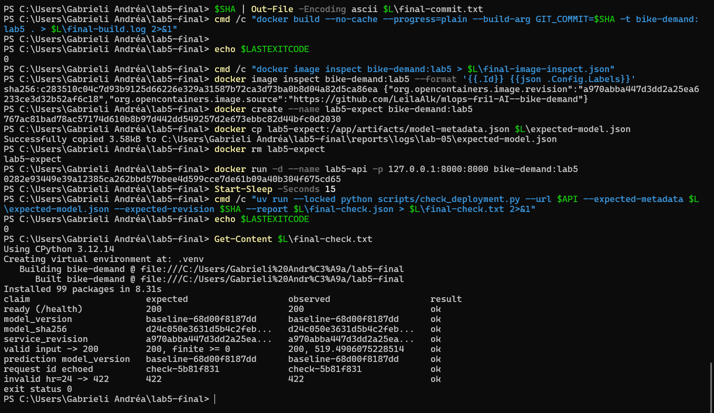
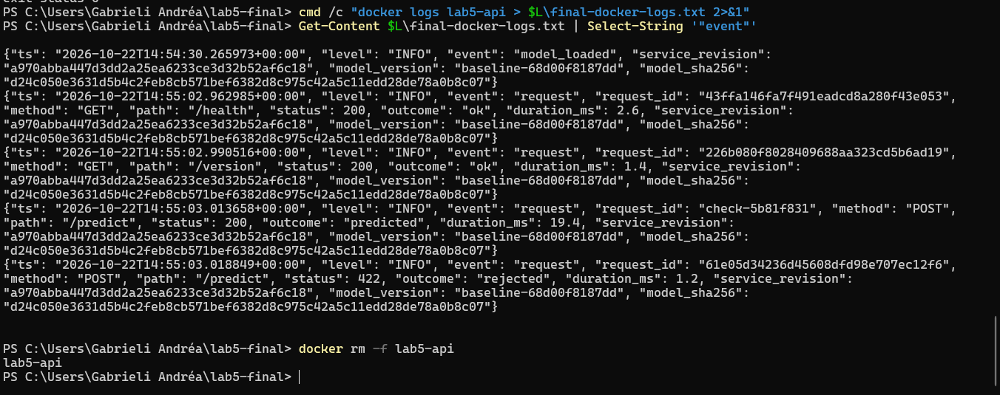
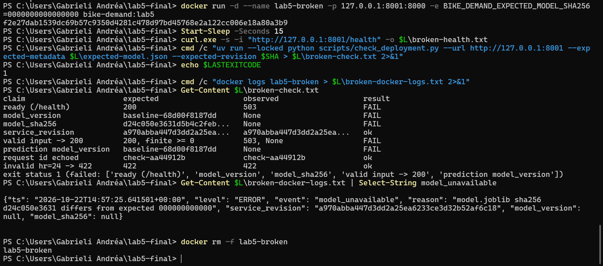
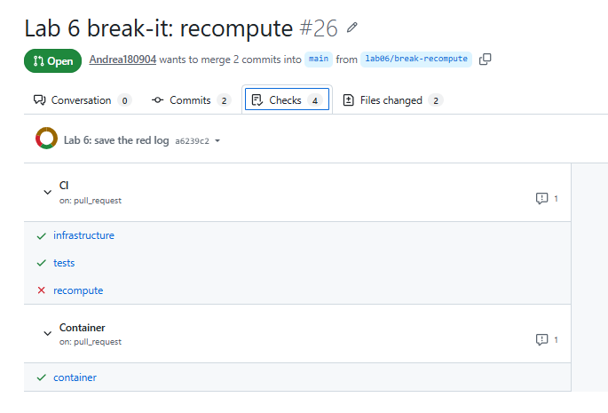
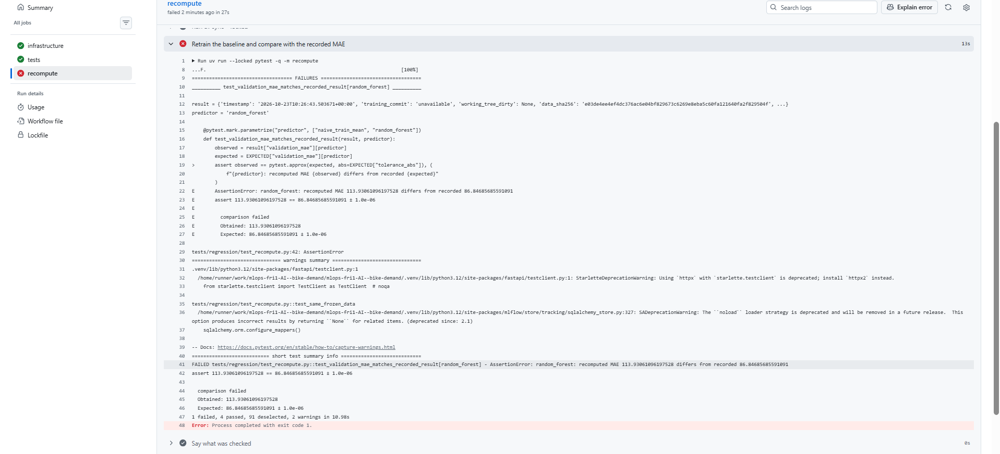
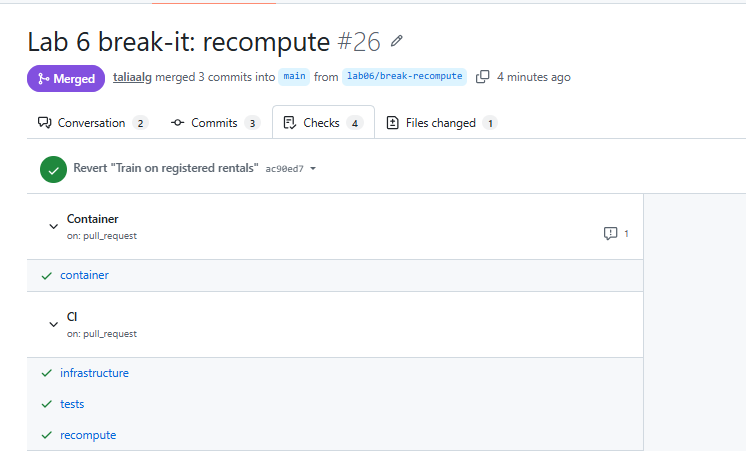

# Week 3, Labs 5-6: team evidence

## Lab 5: deploy, log and check the service

### Team and roles

| Part | Author | Reviewer | PR |
| --- | --- | --- | --- |
| Start-up: settings, `/version`, fail-closed expected hash | Talia | Andrea | #17 |
| Structured logging: one JSON line per request | Julia | Leila | #18 |
| Deployment check script | Andrea | Talia | #19 |
| README "Lab 5: deploy and check the service" | Leila | Julia | #20 |
| Final check from a fresh clone + this section | Andrea | Talia | #21 |

"Deployed" is defined in the README (Lab 5 section): image from a known commit,
started with the README command, `scripts/check_deployment.py` exits 0 against
the running container, and the log lines show which model and code answered.
The final check was run by Andrea, who did not write the start-up code or the README.

### Commit -> image -> run

- Commit: `a970abba447d3dd2a25ea6233ce3d32b52af6c18` ([final-commit.txt](logs/lab-05/final-commit.txt)).
- Image: `sha256:c283510c04c7d93b9125d66226e329a31587b72ca3d73ba0b8d04a82d5ca86ea`, label `org.opencontainers.image.revision` = `a970abba447d3dd2a25ea6233ce3d32b52af6c18`
  ([image inspect](logs/lab-05/final-image-inspect.json), [build log](logs/lab-05/final-build.log)).
  Command: `docker run -d --name lab5-api -p 127.0.0.1:8000:8000 bike-demand:lab5`.
- Expected model, copied out of the image before start-up:
  [expected-model.json](logs/lab-05/expected-model.json) (`model_version` `baseline-68d00f8187dd`, `model_sha256` `d24c050e3631d5b4c2feb8cb571bef6382d8c975c42a5c11edd28de78a0b8c07`).
- Run: check output [final-check.txt](logs/lab-05/final-check.txt) (8/8 ok, exit 0),
  [final-check.json](logs/lab-05/final-check.json); container logs
  [final-docker-logs.txt](logs/lab-05/final-docker-logs.txt) (one `request` line per call,
  with `request_id`, status, outcome, duration, `service_revision`, `model_version`, `model_sha256`).

### Break it on purpose

Started the same image with `-e BIKE_DEMAND_EXPECTED_MODEL_SHA256=0000000000000000`
(an expected model that is not the one in the image).

- `/health` -> 503 ([broken-health.txt](logs/lab-05/broken-health.txt)).
- Start-up log line `model_unavailable` with
  `"reason": "model.joblib sha256 d24c050e3631 differs from expected 000000000000"`
  ([broken-docker-logs.txt](logs/lab-05/broken-docker-logs.txt)).
- Check: 5 of 8 claims FAIL (ready, `model_version`, `model_sha256`, valid input -> 200, prediction `model_version`); `service_revision`, request id and the 422 rejection still pass; exit status 1 ([broken-check.txt](logs/lab-05/broken-check.txt)).
- Could a stranger find the cause? Yes: the start-up log line `model_unavailable` names both hashes (loaded `d24c050e3631`, expected `000000000000`) and the code revision, and the check output shows that only the model claims fail while the code identity and input validation still work. The fix is to start without the wrong `BIKE_DEMAND_EXPECTED_MODEL_SHA256` (or with the real hash).

### Reviews

- Start-up PR (#17) reviewed by Andrea: changed how it starts with `-e BIKE_DEMAND_EXPECTED_MODEL_SHA256=0000000000000000`; `/health` returned 503 naming both hashes (`d24c050e3631` vs `000000000000`) and `/version` reported `"ready": false` with null model fields. Without the override the service was ready and `service_revision` matched the branch commit (`a22929e6`). Approved.
- Logging PR (#18) reviewed by Leila: asked to change the reviewer section and add @LeilaAlk; otherwise "everything is clear". Approved.
- Check script PR (#19) reviewed by Talia: built the image from `lab05/check` (`6b8f62c`), copied `model-metadata.json` out with `docker cp` and ran the script over HTTP: correct expectations 8/8 ok, exit 0; `--expected-revision 0000000` only `service_revision` FAIL, exit 1; container stopped: all 8 claims FAIL, exit 1 (the script never reports ok when it cannot check). Observation: when the service is down the output does not say why (connection refused); a one-line "cannot reach" message would help. Not blocking. Approved.
- README PR (#20) reviewed by Julia (followed only the README from a fresh clone at `9943cf3`): check 8/8 ok, exit 0; `/version` 200 with the right `service_revision`, ready true, `X-Request-ID` present. Restarted with `BIKE_DEMAND_LOG_LEVEL=WARNING`: `/health` still 200 but no JSON log line at all, not even `model_loaded`, so a reader of the logs alone could not tell which model and code run. Asked to document that WARNING hides the start-up line and that the deployment check expects the default INFO level; also noted the empty PR description. Approved.
- Final check PR (#21) reviewed by Talia: see the PR conversation.

### Blocked steps

None.

### Local runs vs CI

The image build, the container runs, the HTTP checks and the logs above were
produced locally with Docker Desktop. GitHub Actions does not build the image or
run the deployment check yet (Lab 6 will add this).

## Lab 6: continuous integration and regression tests

### Team and roles

| Part | Author | Reviewer (break-it PR) | PR | Break-it PR |
| --- | --- | --- | --- | --- |
| Regression tests: recompute + pytest markers | Talia | Andrea | #22 | #26 |
| CI workflow: ordered jobs, marker guard | Leila | Julia | #25 | #27 |
| Container job: build, test inside, check from outside | Julia | Talia | #24 | #28 |
| README "Lab 6: continuous integration" + defect map | Andrea | Leila | #29 | #30 |
| This section | Andrea | Julia | this PR | – |

Checks required to merge (team agreement): `infrastructure`, `tests`, `recompute`,
`container`, all green, plus one approving review. In branch protection, `infrastructure`,
`tests` and `recompute` are marked required; Leila adds `container` before tagging `m3`.

### What runs (from the README)

`CI` workflow: `infrastructure` (lock, preflight, ruff) -> `tests` (marker guard,
infra, lab1, exercise, api) and `recompute` (retrain, compare with the recorded MAE
within 1e-6). `Container` workflow: build the image from the commit, pytest inside,
start it, `scripts/check_deployment.py` from outside.

Both workflows ran green on every PR above after its repair (Checks tab of each PR), and on `main`
after the last merge, commit `8ae8494` (PR #30): https://github.com/LeilaAlk/mlops-fri1-AI--bike-demand/commit/8ae8494.

### Red -> cause -> green (break-it PRs)

| Break-it PR | Defect (chosen by the reviewer) | First red check / step | Cause found in the log | Repair commit | Green run |
| --- | --- | --- | --- | --- | --- |
| #26 (Andrea -> Talia) | `train.py` fitted the model on `registered` instead of `cnt` (`d72f189`) | CI / `recompute`, step "Retrain the baseline and compare with the recorded MAE"; `tests` and `container` stayed green | `random_forest: recomputed MAE 113.93061096197528 differs from recorded 86.84685685591091` (1 failed, 4 passed: same data and split, only training changed) | `ac90ed7` (revert) | [checks](https://github.com/LeilaAlk/mlops-fri1-AI--bike-demand/pull/26/checks) |
| #27 (Julia -> Leila) | new test `tests/test_capacity.py` with no pytest marker (`a3a4596`): it would never run in CI | CI / `tests`, step "Every test belongs to a group" | `Some tests have no registered marker and would never run in CI`; unmarked test listed: `tests/test_capacity.py::test_prediction_is_rounded_to_whole_bikes` | `cf718ca` (revert) | [checks](https://github.com/LeilaAlk/mlops-fri1-AI--bike-demand/pull/27/checks) |
| #28 (Talia -> Julia) | Dockerfile no longer set `ENV SERVICE_REVISION=$GIT_COMMIT` (`946a3b1`) | Container / `container`, step "Deployment check from outside" | `service_revision  ad44bf11fd76…  unknown  FAIL`, `exit status 1 (failed: ['service_revision'])`: right model, but the service no longer knows its commit | `c6d6d0c` (revert) | [checks](https://github.com/LeilaAlk/mlops-fri1-AI--bike-demand/pull/28/checks) |
| #30 (Leila -> Andrea) | `/version` field `model_sha256` renamed to `model_hash` (`7c735e5`) | CI / `tests`, step "API contract, start-up and logging tests"; Container / `container` red too (tests inside the image) | `FAILED tests/test_startup.py::test_version_reports_code_and_model_identity`: diff `- 'model_sha256'` / `+ 'model_hash'`, same value (1 failed, 39 passed) | `0c11819` (revert) | [checks](https://github.com/LeilaAlk/mlops-fri1-AI--bike-demand/pull/30/checks) |

Raw logs of the failing runs, saved as text: [reports/logs/lab-06/](logs/lab-06/).
No check was muted: no `continue-on-error`, `|| true`, skipped test or loosened
assertion; each repair reverted or fixed the defect on the same PR.

Gaps found (a defect no check caught): none. Each of the four defects turned at least one required
check red, and only the checks that cover that part (the tests and the container job both protect the
`/version` contract, which is why #30 turned two checks red).

### Blocked steps

No step stayed blocked. One process note: on #28 and #30 the merge needed one approving review and the
PR author cannot approve their own PR; #30 was approved by Andrea, who had also written the repair,
after all four checks were green. A stricter rule would ask a third member to approve repairs.

### Local runs vs CI

The checks above were run by GitHub Actions on `ubuntu-24.04` runners from the
commit and `uv.lock` only. Local runs (laptops, Docker Desktop) are cited
separately in each personal report and are not CI evidence.

### Checkpoint

Annotated tag `m3` on `main`, created by Leila on the merge commit of this PR, after all Lab 5 and
Lab 6 PRs were reviewed and merged.
