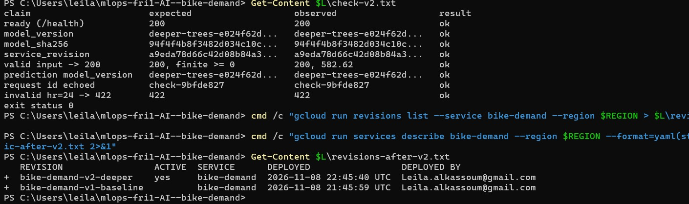

# Week 4 team report

## Lab 7: training pipeline, quality gate and promotion

### Contract and roles

| Part | Author | Reviewer (challenge) | PR |
| --- | --- | --- | --- |
| Gate policy + declared candidates (before any evaluation) | Talia | Andrea | #32 |
| README "Lab 7: pipeline and gate" (design answers) | Andrea | Talia | #33 |
| Pipeline entry point + accepted-store reader + gate tests | Julia | Leila (clean checkout -> blocked; settings guard) | #34 |
| Promotion (reviewed, atomic, keeps the previous version) | Andrea | Talia (unmerged decision; promote a rejected decision) | #35 |
| Release image + Cloud Run + `reports/releases.md` | Leila | Julia | #36, #38, #41, #42 |
| Official runs on the release machine (Julia), approval of each promotion (Andrea) | Julia | Andrea (Cloud Run serves the promoted bytes, #43) | #37, #39, #40 |

Policy committed in `6ef4f25` (PR #32, merged 2026-11-08 14:19 Paris time,
13:19 UTC). First candidate evaluated at 19:57 UTC (Leila's review challenge),
first official decision at 21:21 UTC (`decisions/`): the rule came first.

### Decisions (actual results, release machine: Julia's Windows laptop)

| Record | Candidate | Outcome | Candidate MAE | Accepted MAE | Gain | Size, p95 | Reason |
| --- | --- | --- | --- | --- | --- | --- | --- |
| `decisions/20261108T212133Z-baseline-eligible.json` | baseline (bootstrap) | eligible | 86.847 | - | matches Lab 2 record (86.846857) | 5.2 MB, 7.54 ms | bootstrap of the Lab 2 accepted model |
| `decisions/20261108T215541Z-shallow-trees-rejected.json` | shallow-trees | **rejected** | 98.079 | 86.847 | -11.232 | 0.1 MB, 6.33 ms | `gain_vs_accepted` failed (rule ≥ 0.5) |
| `decisions/20261108T215758Z-deeper-trees-eligible.json` | deeper-trees | eligible | 86.039 | 86.847 | +0.807 | 37.1 MB, 6.96 ms | all checks passed |

The gain of the promoted candidate is small (0.807 bikes/hour, 0.93%) and
measured on one validation window: it is a reason to promote under our policy,
not proof of better accuracy in the future. Its file is about 7 times larger
(37.1 MB vs 5.2 MB).

### Rejection preserved the accepted state

Registry hashes and the live service identity before and after the rejected
run are identical (`fc`: no difference for both pairs):
[`reports/logs/lab-07/reject-before.txt`](logs/lab-07/reject-before.txt),
[`reject-after.txt`](logs/lab-07/reject-after.txt),
[`service-before-reject.json`](logs/lab-07/service-before-reject.json),
[`service-after-reject.json`](logs/lab-07/service-after-reject.json).
Cloud Run kept serving `baseline-51e768eff2cb` (v1) both times.

### Promotion and serving

| Version | Approved by | Promoted from main commit | Cloud Run revision | Verified from outside |
| --- | --- | --- | --- | --- |
| `baseline-51e768eff2cb` | Andrea | `230d462` | `bike-demand-v1-baseline` (retained) | 8/8, exit 0 ([`check-v1.txt`](logs/lab-07/check-v1.txt)) |
| `deeper-trees-e024f62d651a` | Andrea | `a9eda78` | `bike-demand-v2-deeper` (serving 100%) | 8/8, exit 0 ([`check-v2.txt`](logs/lab-07/check-v2.txt)) |

Promotion of v2 (2026-11-08 22:28 UTC) names `previous = baseline-51e768eff2cb`:
the replaced version is kept ([`promote-v2.txt`](logs/lab-07/promote-v2.txt),
[`registry-after-v2.txt`](logs/lab-07/registry-after-v2.txt)).
Details: [`reports/releases.md`](releases.md).

### Challenges (reviewers on work they did not build)

| Reviewer | Claim challenged | Prediction | Observed | Gap / repair |
| --- | --- | --- | --- | --- |
| Leila | a missing check never passes | blocked, exit 4 | BLOCKED, `gain_vs_accepted: missing` (no accepted model); with `random_state: 7`: BLOCKED, "random_state must stay 42", no model trained ([`challenge-leila-no-accepted.txt`](logs/lab-07/challenge-leila-no-accepted.txt), [`challenge-leila-guard.txt`](logs/lab-07/challenge-leila-guard.txt)) | none |
| Talia | an unreviewed or rejected decision cannot replace the accepted one | refused, registry unchanged | unmerged bootstrap decision: ELIGIBLE (0) but promotion refused (1), "is not committed: merge it through a PR", `registry/current.json` not created; rejected shallow-trees: refused (1), "only 'eligible' can be promoted" ([`challenge-talia-promote.txt`](logs/lab-07/challenge-talia-promote.txt), [`challenge-talia-promote-rejected.txt`](logs/lab-07/challenge-talia-promote-rejected.txt)) | none |
| Andrea | Cloud Run serves the exact promoted bytes | same sha in `/version` | v2 expectation: 8/8 ok; old v1 expectation: `model_version`, `model_sha256`, prediction `model_version` FAIL, exit 1 ([`challenge-andrea-ok.txt`](logs/lab-07/challenge-andrea-ok.txt), [`challenge-andrea-old.txt`](logs/lab-07/challenge-andrea-old.txt)) | none |

### Local vs CI, blockers, limits

CI runs `pytest -m gate` with a throwaway registry on every PR. Official
decisions and promotions were made on the release machine (Julia), deployments
with `gcloud` from Leila's laptop: they are local evidence, kept as raw text.
Blockers: none. The gate cannot know whether the gain holds after June 2012,
nor Cloud Run latency: p95 is measured on the machine that runs the pipeline
(6.96 ms on the release machine, 22.12 ms for the same model on Leila's laptop).
